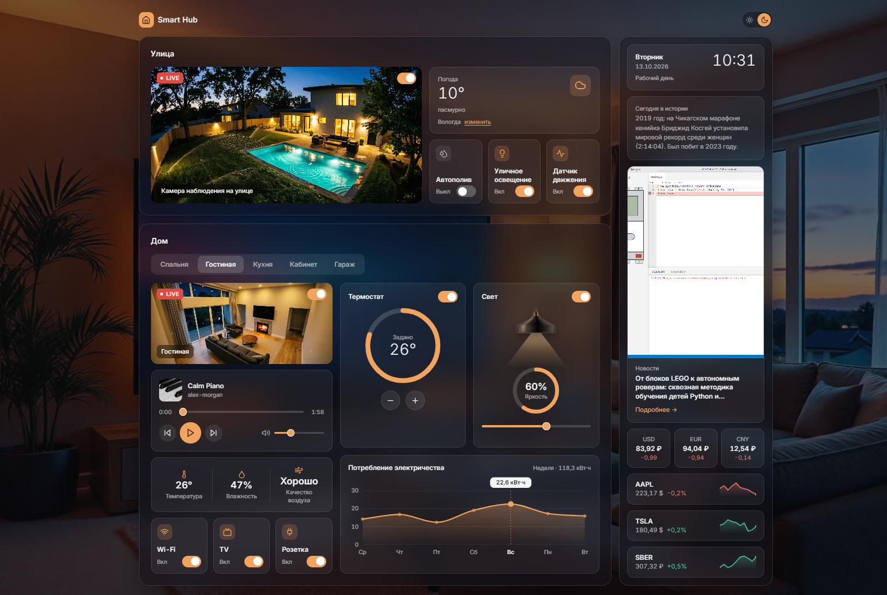

# Smart Hub

<div align=center>




</div>

---

**Smart Hub** — единая панель управления умным домом в браузере: камеры, свет,
климат, музыка, датчики и энергопотребление на одном экране, плюс полезные
данные дня — погода, курсы валют, новости. Интерфейс адаптируется к времени
суток и работает в светлой и тёмной теме.

## 🎯 Для чего это

- **Одно окно вместо множества приложений.** Управление устройствами разных
  типов и мониторинг дома собраны в одном месте.
- **Наглядность с первого взгляда.** Живые показания датчиков, состояние
  устройств и динамика потребления энергии видны сразу, без переходов по экранам.
- **Основа для реального продукта.** Архитектура позволяет подключить настоящие
  устройства и серверную часть, не переписывая интерфейс.

## ✨ Возможности

**Управление домом**
- 🏘️ Комнаты — Спальня, Гостиная, Кухня, Кабинет, Гараж и отдельная секция «Улица»
- 📷 Камеры видеонаблюдения с live-индикатором и возможностью отключения
- 💡 Умный свет — регулировка яркости, визуализация светового конуса лампы
- 🌡️ Термостат с автоматическими режимами нагрева, охлаждения и ожидания
- 🔌 Тумблеры устройств — Wi-Fi, TV, розетка, автополив, уличное освещение,
  датчик движения
- 🚨 Уведомления по показаниям датчиков

**Мониторинг**
- 📊 Датчики температуры, влажности и качества воздуха с живой динамикой
- ⚡ График энергопотребления за неделю с подсказками по наведению
- 🎵 Музыкальный плеер: перемотка, громкость, переключение композиций

**Информация дня**
- ☀️ Погода по названию города
- 💱 Курсы валют USD / EUR / CNY
- 📈 Котировки акций
- 📰 Лента новостей
- 📅 Факт «сегодня в истории» и статус дня (рабочий, выходной, праздничный)

**Интерфейс**
- 🌗 Светлая и тёмная темы: фон плавно переключается день ⇄ ночь, выбор
  запоминается
- 💾 Состояние устройств сохраняется между визитами
- 📱 Адаптивная вёрстка под разные размеры экрана
- ♿ Доступность: управление с клавиатуры, подписи для экранных читалок

## 🖥️ Технологии

| Слой        | Инструменты                                    |
| ----------- | ---------------------------------------------- |
| UI          | React 18, TypeScript                           |
| Стили       | CSS-токены, методология BEM, Tailwind CSS      |
| Состояние   | Zustand                                        |
| Сборка      | Vite                                           |
| HTTP-клиент | Axios                                          |
| Тесты       | Jest, React Testing Library                    |

## 🧩 Архитектурные решения

- **Клиентское SPA без бэкенда.** Показания датчиков, музыка и котировки
  симулируются прямо в браузере, поэтому демо работает без серверной части и
  оборудования.
- **Разделение данных и интерфейса.** Состояние вынесено в отдельные Zustand-сторы
  (устройства, датчики, музыка, котировки, тема), компоненты только отображают его.
- **Отказоустойчивые внешние данные.** Погода запрашивается из нескольких
  независимых источников одновременно, остальные сервисы — с резервными
  провайдерами и локальными запасными значениями. Ни один сбой не ломает экран.
- **Единая дизайн-система.** Все цвета заданы токенами для двух тем, общие
  компоненты (`Slider`, `Ring`, `Switch`, `Icon`) выглядят одинаково везде.
  Стили написаны по BEM.
- **Типизация.** Весь код на TypeScript со строгим режимом.

## 🗂️ Структура проекта

```
src/
├── api/                    # внешние API: погода, курсы, новости, статус дня
├── data/seedData.ts        # данные комнат, устройств, музыки, акций
├── hooks/                  # симуляция датчиков/музыки/котировок, размер графика
├── store/                  # Zustand-сторы
├── components/
│   ├── ui/                 # общие примитивы: Icon, Switch, Slider, Ring
│   └── ...                 # карточки: камера, термостат, свет, плеер, график
├── pages/DashboardPage.tsx # главный экран
├── styles/index.css        # дизайн-токены и BEM-стили
└── utils/                  # форматирование, иконки погоды, пути к ассетам
```

## 🌐 Источники данных

| Функция                  | Источник                                                    |
| ------------------------ | ----------------------------------------------------------- |
| Погода                   | wttr.in, Open-Meteo, MET Norway                             |
| Курсы валют              | cbr-xml-daily.ru (зеркало ЦБ РФ), резерв — currency-api     |
| Статус дня               | isdayoff.ru, резерв — Nager.Date                            |
| Факт «сегодня в истории» | Wikipedia REST                                              |
| Новости                  | Habr RSS, резерв — Lenta RSS                                |

Комнаты, устройства, датчики, музыка, котировки и график энергии — локальные
демо-данные с реалистичной симуляцией, без физического оборудования.

## 🚀 Запуск

```bash
npm install
npm run dev
```

Откройте [http://localhost:5173](http://localhost:5173) — дашборд открывается
сразу, без регистрации.
